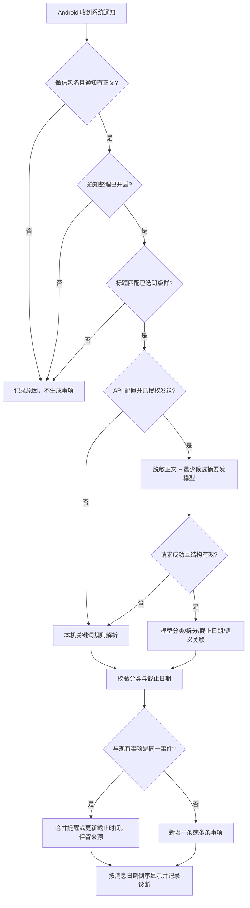
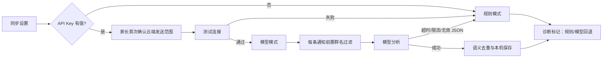
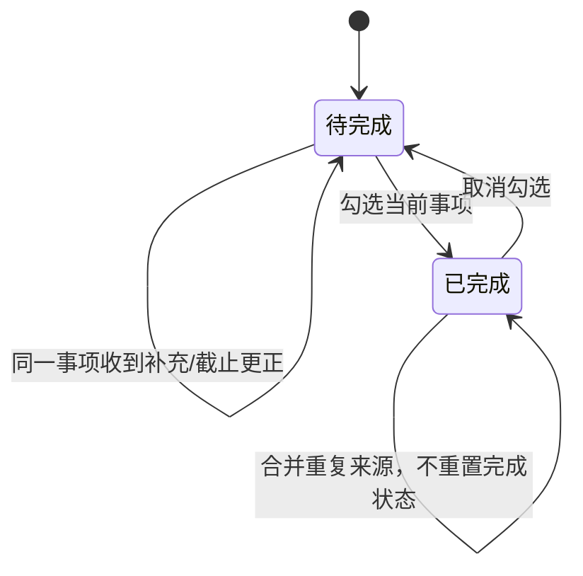

# 班务清单 Android 试点增强版｜识别与交互流程

## 自动通知整理

### 处理顺序

1. Android 仅传入系统通知字段；先过滤应用包名、暂停状态、正文是否存在。
2. 本机匹配家长选择的班级群，未匹配不调用模型。
3. API 未填/关闭时走原规则；API 已填且家长同意后，移除设备无关信息并将孩子姓名替换成“孩子”。
4. 模型返回 JSON：类别、动作摘要、可拆分事项、发送人、截止时间候选、是否需回复、与候选事项的关系、简短判定理由。无法解析的响应不写入事项。
5. 本机校验输出：消息截止时间 > 用户设定的作业默认值 > 无法判断时标注“未注明”。
6. 语义去重：同一活动的补充/重复提醒合并；若为截止日更正，更新旧项截止日期并保留更正来源。仅相似但无法确认同一事项时保留两项，避免误合并。
7. 完成勾选始终由家长操作；识别成功只代表候选事项，不表示已完成。

## 截止日期规则优先级

| 优先级 | 输入情形 | 截止日期 |
|---|---|---|
| 1 | 原消息写明具体日期/时间 | 使用消息明确时间 |
| 2 | 可判断是周一至周四布置的作业，且没有明确期限 | 当天 21:00 |
| 3 | 周五、周六或周日布置的作业，无明确期限 | 对应周日 19:00 |
| 4 | 作业安排落在已知法定假期 | 假期最后一天 19:00 |
| 5 | 非作业，且模型/规则无法判断日期 | 显示“未注明”，不擅自加期限 |

待确认的边界策略：若默认时间已过，建议顺延到下一个合理期限；具体已在 `phase1-context.md` 列出。节假日依赖本机维护的日期表，缺少日期数据时明确提示，不能猜测。

## 模型设置与错误回退

状态文案区分：`规则识别`、`模型识别`、`模型不可用，已用规则回退`、`等待家长确认`。用户清除 Key 或关闭模型开关后立刻回到规则模式。

## 拍照补录

1. 首页点击原位置的“手动补充” → 选“拍照”。
2. 用户授权相机后拍摄；可重拍或取消。
3. 手机本地 OCR 提取文字和可见日期，不上传照片。
4. 显示“识别文字”编辑区及任务字段；API 开启时仅在已同意后把编辑后的文字发模型整理。
5. 家长核对内容、日期、布置人（默认爸爸）和类别 → 保存到原清单。

失败状态：无相机权限时提示前往系统设置；模糊/无文字时提示重拍或手动输入；离开页面不保存临时照片。

## 语音补录

1. 首页点击原位置的“手动补充” → 选“语音”。
2. 用户点按开始/结束；Android 语音识别服务转成文字，屏幕显示录音状态和转写进度。
3. 音频不上传给班务清单服务，也不长期保存；语音识别是否使用设备外服务由 Android/厂商语音服务决定，首次使用时说明。
4. 家长编辑转写文本；API 开启且已同意时整理文本，否则使用本机规则。
5. 核对任务字段 → 保存。

失败状态：无麦克风权限、系统无语音识别服务、无网络或空转写时，保留文字输入入口，不生成空任务。

## 清单状态切换

事项勾选后自动从当前待完成列表消失，计数同步减少；页面仍保持在待完成视图。手动取消勾选后回到待完成列表。

## 诊断与隐私

诊断保存阶段状态和结果码：收到/过滤、群名匹配、规则或模型请求、JSON 校验、分类、重复合并/新增、回退原因。复制前再次过滤 Key、接口认证头和正文；用户可单独复制完整脱敏步骤用于排查。API Key 不进入诊断和导出文本。
