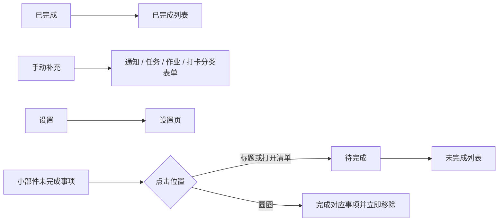

# 首页、小部件与设置页调整方案（评审稿）

> 本文是界面与交互设计稿，供确认方向；本轮没有修改程序、资源文件或 APK。页面命名沿用现有信息架构：P01 首页（含桌面小部件入口）、P02 手动补充、P06 设置。

## 1. 首页入口区

将首页原“待完成 / 已完成”切换栏原位改为四个等宽图标入口，顺序固定为：待完成、已完成、手动补充、设置。原有左下角“设置”和“手动补充”悬浮圆形按钮取消，避免重复入口。点击前两个入口切换列表；点击手动补充打开原补充面板；点击设置打开设置页。

```text
┌────────────────────────────────────────────┐
│ 班务清单                         群消息同步状态 │
│                                            │
│  [○ 待完成  3] [✓ 已完成 35] [＋ 补充] [⚙ 设置] │
│                                            │
│ 学习作业  10月8日                2待完成 · 6已完成 │
│ ┌────────────────────────────────────────┐ │
│ │ 语文｜在课堂本写……                   ○ │ │
│ │ 数学｜根据网课内容完成今天的新课任务 ○ │ │
│ └────────────────────────────────────────┘ │
│ 群消息  10月8日                  2待完成 · 0已完成 │
│ ┌────────────────────────────────────────┐ │
│ │ [通知] 明天23点放学                   ○ │ │
│ │ [任务] 填写少儿互助金情况统计          ○ │ │
│ │ [打卡] 每日阅读30分钟                  ○ │ │
│ └────────────────────────────────────────┘ │
└────────────────────────────────────────────┘
```

### 入口与列表规则

- 四个入口沿用当前待完成/已完成选择状态的视觉位置。选中项用浅色底和主色图标/文字突出，其他项保持中性；图标与文字同时显示，避免只靠图形猜含义。
- 待完成、已完成计数分别显示在标签旁。手动补充与设置不显示数量。
- 选择“待完成”时，列表只显示未完成项目；选择“已完成”时，列表只显示已完成项目。完成一项后从当前待完成列表移除，计数即时更新。
- 学习作业保持作业表格卡片形式，表格只呈现每条具体作业和独立勾选状态；单项勾选不影响其他项，全部勾选后整张作业才进入已完成。
- 群消息按日期分组，显示待完成/已完成数量。已完成的群消息在待完成视图中消失；在已完成视图查看。

## 2. 桌面小部件

小部件顶部显示“孩子的班级消息待办”，下面按未完成状态列事项。通知、任务、作业、打卡均纳入显示；已完成事项不显示。此处保留作业类别，是因为现有清单已包含学习作业。小部件的勾选直接完成对应事项，完成后立即从小部件移除。

```text
┌──────────────────────────────┐
│ 孩子的班级消息待办             │
│                              │
│ ○ [作业] 学习作业 · 2/8         │
│   截止 10月9日 21:00            │
│ ○ [通知] 明天23点放学            │
│   截止 10月9日 23:00            │
│ ○ [任务] 填写互助金情况统计      │
│   截止 10月8日 20:00            │
│ ○ [打卡] 每日阅读30分钟          │
│                              │
│          打开班务清单 ›          │
└──────────────────────────────┘
```

- 小部件不显示群聊名单；只显示标题和未完成事项，已完成项目不以灰字、删除线或历史记录形式出现。
- 作业卡片按未完成子项显示进度，例如“学习作业 · 2/8”；点击圆圈完成当前单项，最后一项完成后整组消失。
- 通知、任务、打卡各显示为独立待办；勾选即完成并从小部件移除。
- 小部件空间不足时按待办优先顺序显示可容纳的未完成事项；拉伸后展示更多项目。点击标题/“打开班务清单”进入应用，点圆圈只完成对应项目。
- 没有截止日期时隐藏截止行，不展示“null”或虚构日期。截止日期统一采用“10月8日 · 星期四”样式；具体时间有值时追加时间。

## 3. 首页四入口与小部件操作关系



## 4. 设置页文字层级

全页采用同一系统无衬线字体。用字重、字号和颜色区分层次，不混用多套字体：

1. 页面标题：主标题样式，深色、较醒目。
2. 分区标题：比正文更突出，用于“通知同步”“消息识别”“模型 API”“功能与隐私”“版本信息”等区块。
3. 字段名称和正文：统一常规字重，保证易读；同类字段的字号、行高一致。
4. 辅助说明：比正文弱一级，使用次级灰色；只补充字段含义、权限状态和隐私说明。
5. 状态提示：成功使用绿色、失败使用红色；不靠颜色单独传递含义，配合“已保存”“保存失败”等文字。

```text
设置

通知同步
  通知访问权限                已开启
  监听群聊                    群聊示例一、群聊示例二…

消息识别
  本机规则 / 模型 API          当前模式
  API 地址、模型、密钥         ……
  [测试连接]

功能与隐私
  功能说明、API 发送范围、照片 OCR、数据保存方式

版本信息
  当前版本  0.5.x

                         已保存
```

## 5. 自动保存行为

移除页面底部“保存并返回”。设置页变更自动保存，离开页面不再要求再次确认。

- 开关、单选项和权限相关选择：用户操作后立即保存。
- 文本字段（群名、API 地址、模型名等）：输入停止后短暂等待再保存；失焦时立即提交，避免每敲一个字符都写入。
- 密钥仅在本机安全存储，不显示在诊断记录中；空白字段不覆盖已有密钥。清除密钥必须通过明确的“清除”操作。
- 页面顶部或底部固定位置显示轻量状态：“保存中… / 已保存 / 保存失败，点按重试”。离开页面前提交尚未完成的保存；保存失败时保留输入并明确提示，不悄悄丢弃。
- 自动保存只代表设置已写入本机，不代表用户同意开启模型分析。模型 API 的启用与隐私授权仍需用户明确操作。
- 设置页保留功能说明、API 接入范围和隐私说明，包含通知正文是否脱敏、照片 OCR 本机处理、哪些字段会发送给所配置服务、密钥的保存方式。

## 6. 请核对的设计决定

- 首页顶部切换栏原位变为四个图标入口，底部两个悬浮按钮取消。
- 小部件显示所有未完成类别：通知、任务、作业、打卡；已完成事项不出现。
- 设置输入自动保存，页面不再保留“保存并返回”。

确认后再进入程序修改；若有需要调整的版式、入口位置或类别规则，请直接在此设计稿上指出。
